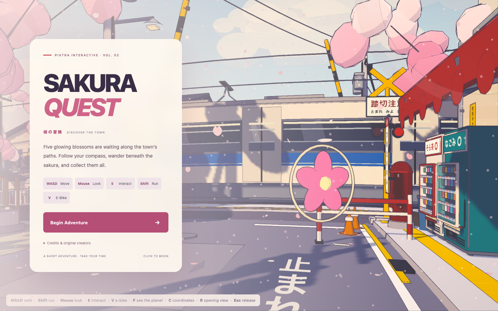

# Sakura Quest · Pixtra Interactive

**Discover the town. Collect five glowing blossoms.** An anime-inspired short exploration adventure adapted from Kenton Wang’s **Sakura Crossing**. Original town and engine credited in [CREDITS.md](CREDITS.md); original [MIT license](LICENSE) preserved.



## Play locally

Use Node **22.x**.

```sh
npm ci
npm run dev
```

```sh
npm run build
npm run preview
```

Click **Begin Adventure** to capture the mouse. WASD moves, mouse looks, Shift runs, E interacts, V calls the e-bike, E mounts/dismounts it. P toggles planet view, Esc pauses/releases the mouse. H toggles hints, R retains the original return-to-opening-view behavior. Use **Restart quest** in the pause screen or **Play again** after completion to reset the whole objective.

Follow the small compass to five blossoms: crossing → shopping alley → lantern street → library corner → shrine approach. Tokens can be collected in any order by moving within 1.8 metres. The compass indicates direction, not an obstacle-avoiding route; use existing paths and the destination hint. The final shrine is reached west along the near-side railway path, then up the narrow shrine alley. A relaxed exploration is intended to take roughly 2–3 minutes; sprinting or the e-bike can be faster. There is no time limit. The timer runs only during active first-person play.

The original movement, collisions, interactions, automatic trains and e-bike remain. The game uses keyboard/mouse and pointer lock; smaller screens have responsive menus, but touch-only gameplay is not provided. Hardware-accelerated WebGL 2 is required. A blocked pointer-lock request can be retried from the menu.

## Deploy to Vercel

1. Import this GitHub repository into a new Vercel project.
2. Framework: **Vite**. Root directory: **.** (repository root).
3. Node.js: **22.x**. Install: `npm ci`. Build: `npm run build`. Output: **dist**.
4. Environment variables: **none**. No backend, custom routing or rewrite configuration required.
5. Deploy in Vercel; this preparation has not deployed anything.

## Verification

The original production build and town rendering were established before changes. [docs/baseline-qa.json](docs/baseline-qa.json) records original console warnings; the unsupported no-op material property and missing favicon were corrected. Production browser results, tested interactions and actual screenshots are in [docs/qa.json](docs/qa.json) and `docs/`. Browser QA uses external Playwright in the parent workspace; no testing dependencies are added to this game.

The source bundles substantial procedural town geometry, so Vite’s large-chunk build warning is expected. Runtime is entirely static and local; the dev-only upstream frame capture endpoint is never part of production.

## Soundtrack

The stock MP3 excluded from the upstream MIT license has been removed. This edition is intentionally silent, its playlist is empty, and no audio request is made. See the [asset audit](CREDITS.md) before adding any soundtrack.
